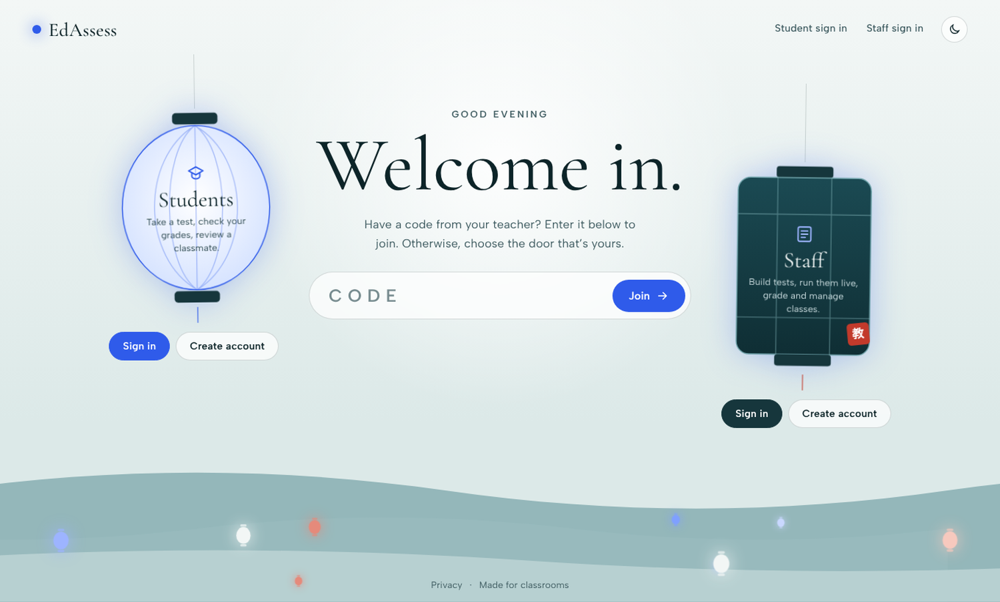
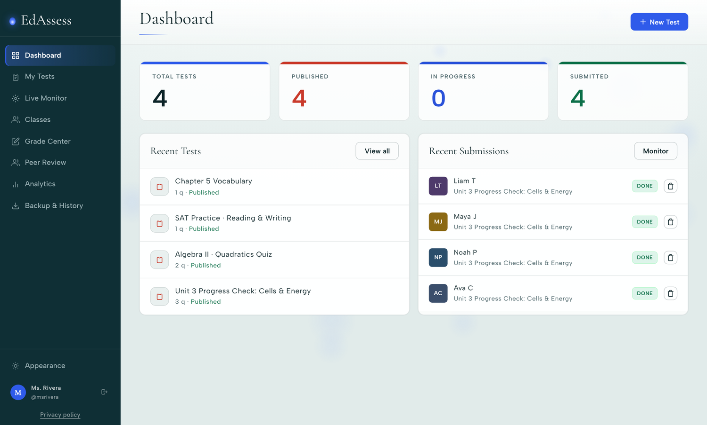
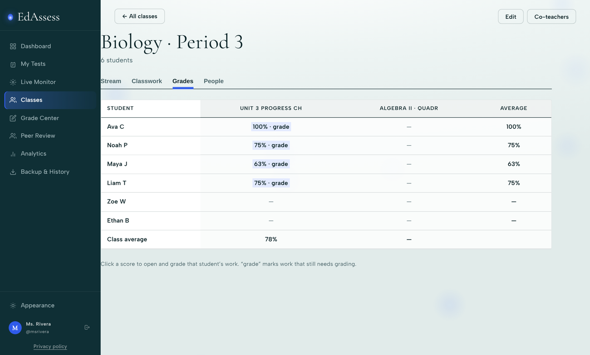
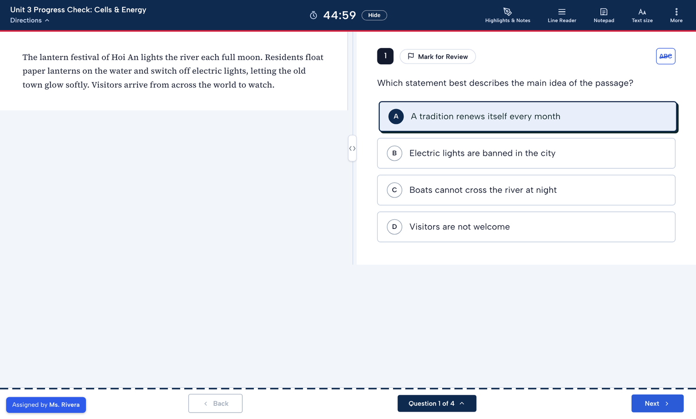

# EdAssess

**Calm, capable assessments and classrooms — from first quiz to final grade.**

Build tests, run them live, grade with confidence, and keep every class in one place. 
Students get a focused, AP-style exam room. Teachers get a quiet workspace that gets out of the way.

[**Open EdAssess →**](https://edassess.netlify.app)

 

---

## What is EdAssess?

EdAssess is a complete home for classroom assessment. A teacher writes a test, hands students a short code (or posts it to a class), watches the room fill in real time, grades the results, and shares scores back — without juggling separate tools for quizzes, rosters, materials and grades.

It runs in the browser, needs no installation for students, and keeps working through shaky Wi-Fi: answers are saved as you go, and if the connection drops your work stays safe on the device until it can sync.

**It's designed around three ideas**

| | |
|---|---|
| 🌙 **Calm by default** | Soft lantern-lit light and night themes, gentle motion, nothing shouting for attention. |
| 🧭 **Everything in one place** | Tests, classes, materials, live monitoring, grading, peer review and analytics share one workspace. |
| 🎯 **Built for real exams** | A focused exam room modeled on AP Classroom, with the tools students actually need. |

---

## For teachers

### The front door
Open EdAssess and you land on a quiet river of floating lanterns. Type a code to **join an assessment** or class straight away, or step through the **Students** or **Staff** lantern to sign in or create an account. Light by default, with a one-tap night mode.

### Your dashboard

See what matters at a glance — tests, what's live, what's waiting to be graded, and the latest submissions.

### Build tests that look like the real thing

- **Question types:** multiple choice, multi-select, short answer, essay / long form, passage + sub-questions, and upload-your-work.
- **Rubrics** for essays, with per-criterion points.
- **Stimulus passages** and documents, with images, for reading and source-based questions.
- **Sections & grading** controls, including **SAT-style sectioned adaptive tests** with scaled scoring.
- **Import questions** from other tests, set per-test text size, instructions and settings, then **Preview** exactly as a student sees it.
- **Autosave** that tells you plainly when everything is saved.

### Keep every test organised

Search, sort by recently edited, filter by type or status, and publish when you're ready.

### Run it live

Hand out a **join code** or post the test to a class. The **Live Monitor** shows each assignment moving from *Not open → In progress → In grading → Done*, with sorting, class filters and grouping so a busy week stays readable. Copy a student link in one click.

### Live Room: a shared screen for group sessions

Open **Live Room** from the sidebar (or **Live room** inside any class) to put a screen in front of your group, standalone or tied to a class.

- **Slides:** type them, add images, import a **PowerPoint (.pptx)** (text, pictures, tables and speaker notes come across; animations and charts do not), or import a PDF or images.
- **Websites and links:** embed a YouTube/Vimeo video, Google Doc/Slides, Desmos and similar on everyone's screen (with an "Open in a new tab" fallback), or push links to students' screens at any time.
- **Hands and questions:** students can raise a hand or message you; you see them in one inbox.
- **Ask anything:** multiple choice, polls, typed answers, and one-tap check-ins (Got it → Lost). Use **Ask now** to drop a question in mid-session without preparing it.
- **See answers arrive:** live bars, typed replies (or a word cloud), who has not answered yet, and a one-click **Reveal answer**.
- **Join in seconds:** students enter the 5-letter code on the front page, or scan the QR.
- **Classroom widgets:** timer, stopwatch, noise level, stop/wait/go signal, a message to show, a shared agenda checklist, scoreboard, name picker, group maker, dice and clock. The timer, signal and message also appear on student screens.
- **What to do next:** when you end the room, results flag questions to reteach, list students to check in with, and export to CSV.

### Classes that feel like a classroom

Every class has a **Stream**, **Classwork**, **Grades** and **People** tab.

- Post announcements and materials; assign a test to the class in a click.
- Invite students by name — they accept from their own account.
- Share a class code, or regenerate it whenever you like.

### Classwork, folded and sorted

Group materials into **topics**, drag to reorder, and keep things tidy: each item is **folded until opened**, then unfolds smoothly — just like the classroom tools students already know. Attach links and notes to any material.

### Grades in one grid

A gradebook for the whole class. Click any score to open that student's work. Averages are calculated for you, and anything still needing a look is flagged.

### Grade with the whole picture

- Auto-grading for objective questions; manual scoring for essays, with rubric buttons.
- **Override scores**, add **comments** the student can read, or apply a **curve**.
- **Peer feedback appears right alongside your grading**, and a single switch hides it from the student if you'd rather.
- Release scores when you're ready.

### Peer review, built in
Pair students up for anonymous, rubric-based feedback on essays. Reviews show up in each student's own account the moment they're assigned — no links to pass around — and finished feedback reaches the student automatically unless you've hidden it.

### And more
- **Grade Center** and **Analytics** for results across assignments.
- **Backup & History** so a careless delete is never permanent.
- **Co-teachers** can share a class.

---

## For students

### A home that's just theirs

Students sign in with a first name and last initial. Everything is on one page: their classes, what's due, their grades, and any peer reviews waiting for them.

### Peer review, in their own account

When a review is assigned, it simply appears. Students read a classmate's response (anonymously, both ways), score the rubric and leave feedback.

### An exam room that stays out of the way

A calm navy-and-white exam screen in the spirit of **AP Classroom**:

- **Timer in the top bar** with a Hide button — never in the way.
- **Question navigator**, **Mark for Review**, and an **answer eliminator**.
- **Directions**, a **Reference** sheet and a built-in **Calculator** where the teacher allows them.
- Passages beside questions, with a draggable divider.
- Autosave on every answer, with a clear "All changes saved".

### Tools that help, not distract

<table>
<tr>
<td width="50%"></td>
<td width="50%"></td>
</tr>
<tr>
<td><b>Line Reader</b> — a spotlight strip that dims everything else. Drag it, resize it, nudge it line by line with <kbd>Alt</kbd>+<kbd>↑</kbd>/<kbd>↓</kbd>, change the dimness, or let it follow the mouse. <kbd>Esc</kbd> closes it.</td>
<td><b>Notepad</b> — private scratch space, one page per question plus a whole-test page. Drag it, resize it, minimise it. Saved on the student's device.</td>
</tr>
</table>

Also in the toolbar: **Highlights & Notes** to mark up passages, and **Text size** to enlarge the reading area. 
**Shortcuts:** <kbd>←</kbd> <kbd>→</kbd> change question · <kbd>A</kbd>–<kbd>D</kbd> pick an answer · <kbd>N</kbd> opens the Notepad.

---

## Made to be comfortable

- **Light by default, night on request** — switch from *Appearance* in the sidebar.
- **Readable everywhere** — text is checked against contrast guidelines in both themes, including hover and selected states.
- **Adjustable text size** and gentle motion that respects *reduce motion* settings.
- **Resilient** — if the connection drops, work is kept on the device and retried automatically.

---

## Getting started

1. **Teachers:** open the app, create an account and press **New Test**.
2. Add questions, hit **Assign**, and share the code or post it to a class.
3. **Students:** open the link or enter the code, add a first name and last initial, and begin.
4. Watch the **Live Monitor**, grade, and release scores.

### Hosting your own

EdAssess is a single page (`index.html`) plus one serverless function (`netlify/functions/data.js`). Deploy the folder to Netlify as-is — data is stored with Netlify Blobs, so there's no database to set up. In your Netlify site settings, add two variables: `EA_AUTH_SECRET` (any long random phrase) and `EA_TEACHER_KEYWORD` (the secret word teachers type to create an account).

---

Made with care for classrooms. Questions or ideas? Open an issue.

