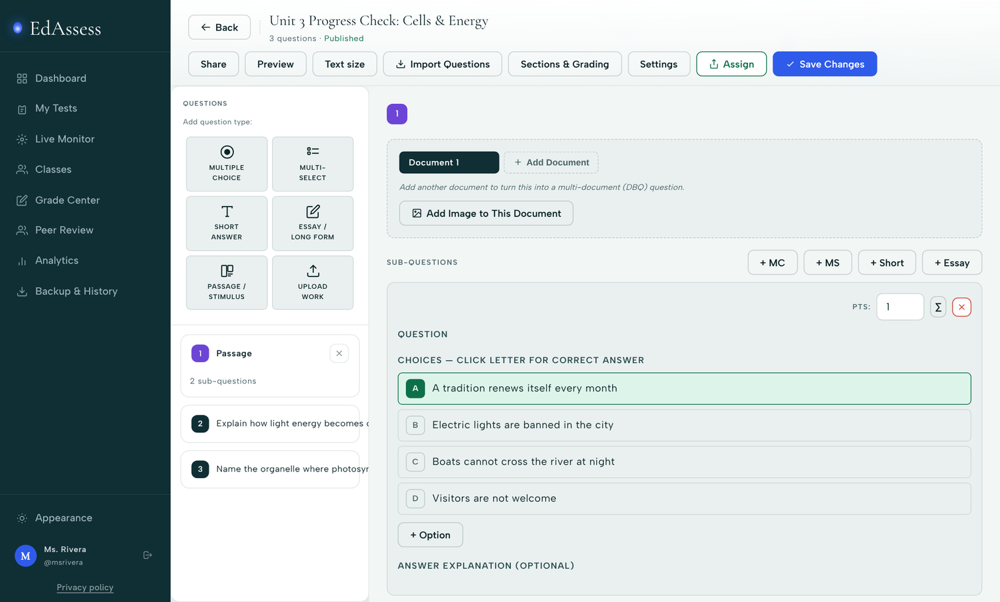
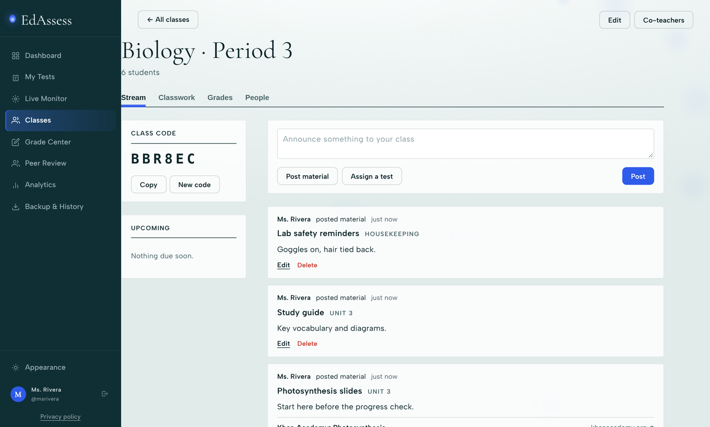
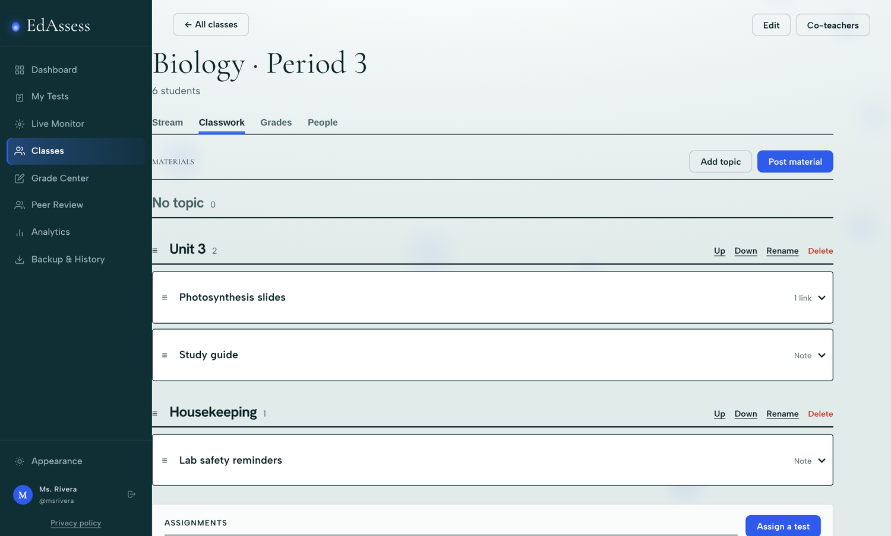
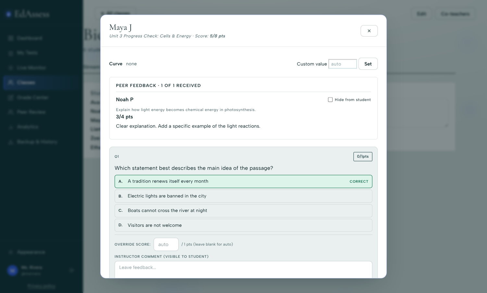
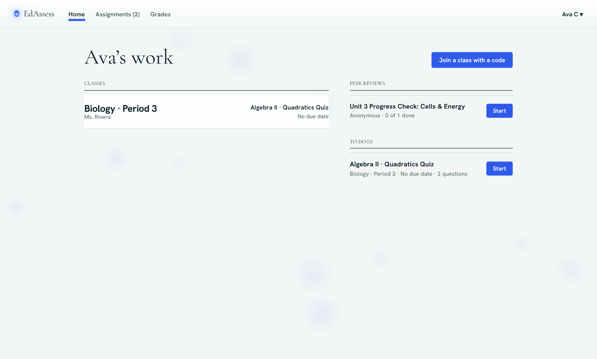
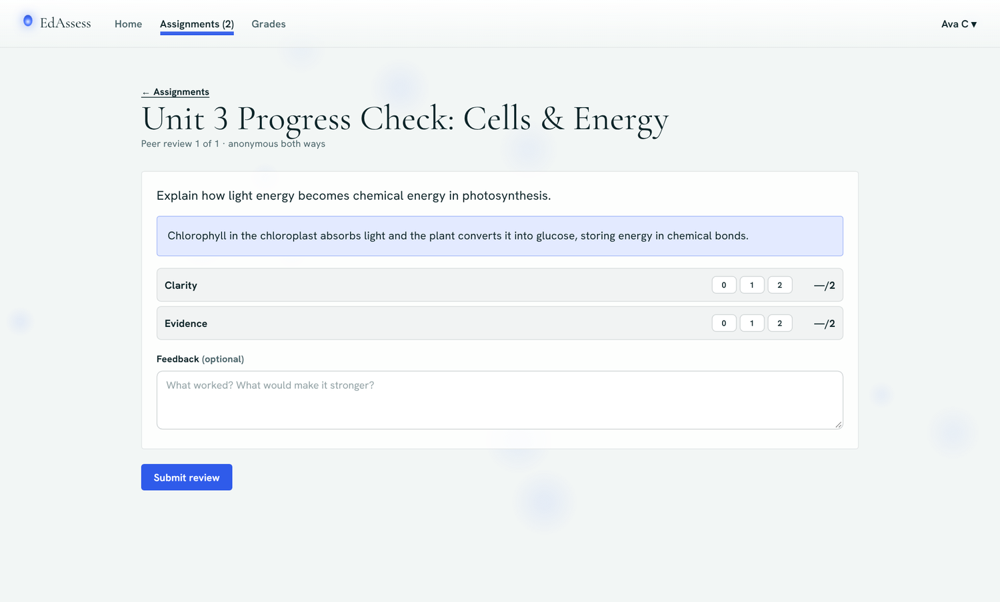
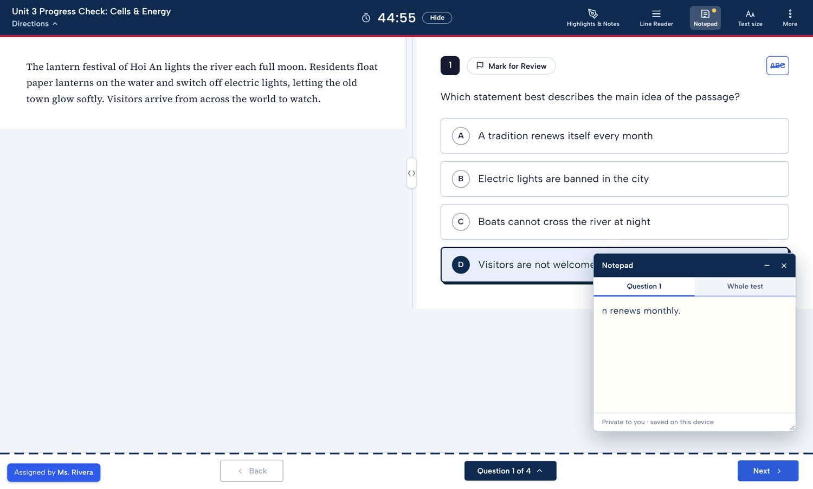

# EdAssess

**A calm place to run tests, surveys and classes.**

Write a test, hand your students a short code, watch the room fill up, and grade it all without leaving the page.

[**Open EdAssess**](https://edassess.netlify.app)

 

---

## Why this exists

EdAssess started as a tool for online tutoring. I kept bouncing between one app for quizzes, another for rosters, a folder of links for materials and a spreadsheet for grades, and none of it talked to the rest. So this puts it all in one spot.

A teacher writes a test, shares a code or posts it to a class, watches students work in real time, grades the results and sends scores back. Students open a link, type a name and start. There is nothing to install, and if the Wi-Fi drops halfway through, their answers are kept on their device and sent when the connection comes back.

Three ideas shaped it:

- **It should be calm.** Light and night themes, gentle motion, and nothing shouting for your attention.
- **It should be one place.** Tests, surveys, classes, materials, live monitoring, grading, peer review and analytics all live together.
- **The exam room should feel like a real exam.** Students get a focused screen modeled on AP Classroom, with the tools they actually need.

---

## If you teach

### The front door
When you open EdAssess you land on a river of floating lanterns. Type a code to join something right away, or pick the Students or Staff lantern to sign in or make an account. It opens in light mode, with night mode one tap away. The lanterns only live on this page, so they never get in your way while you work.

### Your dashboard

Here you can see what's live, what's waiting to be graded and what came in most recently.

### Building a test

You can use multiple choice, multi-select, short answer, essays, passages with sub-questions, and upload-your-work questions. Add rubrics to essays, put images and reading passages beside questions, and build sectioned SAT-style tests with scaled scoring. You can also pull in questions from your other tests, preview everything exactly as a student will see it, and rely on autosave, which tells you plainly when everything is saved.

Your tests are searchable and sortable, so a busy term stays easy to scan.

### Surveys, for when there are no right answers
Sometimes you just want to ask people things. When you create something new, choose **Survey** instead of **Assessment**.

A survey uses the same question types, but there are no points, no answer keys, no rubrics and no lockdown. Students answer and see a simple thank-you. Nothing is ever scored, and surveys stay out of the Grade Center and your averages.

The results are built for reading patterns, not grading:

- how many people responded, the response rate for a class, and how long it usually takes
- a bar chart for every choice question, with counts and percentages
- an average and median for rating scales such as 1 to 5 or Strongly disagree to Strongly agree
- written answers in one place, with the most common words pulled out
- every individual response, plus a CSV you can open in a spreadsheet
- a **Hide names** switch if you would rather see "Respondent 1, 2, 3"

One honest note: hiding names changes what you see on screen. Students still type a name to get in, so if you need truly anonymous answers, tell them to leave it generic.

### More ways to ask
Besides multiple choice, multi-select, short answer and essays, you can now add:

- **Ranking:** students put items in order. In an assessment it's scored (with optional partial credit). In a survey you see each item's average rank.
- **Matching:** students pair items from a shuffled menu. Scored, with optional partial credit.
- **Fill in the blanks:** write a sentence and put answers in double curly braces, like `{{Paris}}` or `{{color|colour}}` for more than one accepted answer. Each blank can earn partial credit.
- **Number:** a typed number, graded within a tolerance you choose (or just collected in a survey, with the average, median and spread).
- **Rating:** stars, numbers, or a 0 to 10 recommend scale (surveys). You get the distribution, the average and a recommend score.
- **Grid:** rows of statements against a scale such as Strongly disagree to Strongly agree (surveys), with a heat-mapped summary.
- **Availability calendar (surveys):** pick a date range, weekdays, a daily window, a slot length and your own time zone. Each student sees the grid in their own time zone (they can change it) and clicks or drags across the times they can do. Your results show a heat map and a "best times" list, and you can switch the time zone you view them in.

### Running it live

Hand out a join code or post the test to a class. The Live Monitor shows each assignment moving from Not open to In progress to In grading to Done, and you can sort, filter by class and group things so a heavy week stays readable. Students can message you from inside the exam, and you can reply with more than one line when a quick answer won't do.

### Classes that feel like a classroom

Every class has a Stream, Classwork, Grades and People tab. You can post announcements and materials, assign a test in a click, invite students by name and share a class code you can regenerate whenever you like.

Assignments are pinned to the top of Classwork, and everything below is compact so you can see more at once. Each post shows when it went up.

Group materials into topics and drag them into order. Each item stays folded until you open it.

### Google Drive
In **Post material** you can press **Add from Google Drive**, sign in with Google once, and pick Docs, Sheets, Slides, Forms, PDFs, folders or uploads. Choose **Embed** and students can preview the file right on the page. Students never have to sign in to Google or anything else. They just click a link or press Preview. By default EdAssess marks picked files as "anyone with the link can view" so students can open them.

Any Google link you paste into the Links box is recognized automatically, so this works even before the picker is set up.

**Turning on the picker (once, about ten minutes)**
1. In Google Cloud Console, create a project and enable the Google Picker API and the Google Drive API.
2. Create an OAuth client ID (Web application) and add your site address under Authorized JavaScript origins.
3. Create an API key and restrict it to your site and the Picker API.
4. In Netlify, set `GOOGLE_CLIENT_ID`, `GOOGLE_API_KEY` and `GOOGLE_APP_ID` (the project number), then redeploy.

EdAssess only asks for the `drive.file` permission, which covers the files you pick and nothing else in your Drive.

### Student view
Inside any class, **Student view** opens the student side in a new tab, so your own tab stays signed in as you.

- **Preview this class** shows the stream, classwork and grades exactly as students see them. It's read-only, so nothing you click gets saved.
- **View as a student** lets you pick one student (or use the button on the People tab) and use the app as them, including taking or submitting an assignment. The work is saved to their account and marked as done by you. Changing their password and joining or leaving classes are switched off.

A bar across the top always tells you who you are viewing as, with an **Exit student view** button. These sessions last two hours.

### Teachers can be students too
Sometimes a teacher joins someone else's class to learn, not to teach. To invite a colleague, type `@theirusername` in the invite box. They press **Student mode** in their sidebar, which opens a new tab as their own student identity. From there they accept the invite or enter a class code, do the work and see their grades. Their teaching account is never touched, and **Back to teacher mode** closes the tab.

### Grading with the full picture

The class gradebook is one grid. Click any score to open that student's work. Averages are worked out for you, and anything that still needs a look is flagged.

Objective questions are graded automatically and essays by hand, with rubric buttons to speed that up. You can override a score, leave comments (line breaks and all), or apply a curve. Peer feedback appears right next to your grading, and one switch hides it from the student if you prefer. Release scores when you're ready.

### Peer review
Pair students up for anonymous, rubric-based feedback on essays. The review shows up in each student's own account the moment it's assigned, so there are no links to pass around. Finished feedback reaches the author automatically unless you have hidden it.

### And a few more things
- **Grade Center** and **Analytics** for results across assignments
- **Backup and History**, so a careless delete is never permanent
- **Co-teachers** who can share a class with you

---

## If you're a student

### Your own home

Sign in with a first name and last initial. Your classes, what's due, your grades and any peer reviews waiting for you are all on one page. An account is optional for many assessments. If your teacher gave you a code, you can usually just type it in.

### Peer review

When a review is assigned to you, it simply appears. You read a classmate's response (they won't know it's you, and you won't know it's them), score the rubric and leave feedback.

### The exam room

The exam screen is calm and navy and stays out of your way, in the spirit of AP Classroom:

- a timer in the top bar that you can hide
- a question navigator, Mark for Review and an answer eliminator
- Directions, a Reference sheet and a built-in Calculator when your teacher allows them
- passages beside the questions, with a divider you can drag
- autosave on every answer, with a clear "All changes saved"

### Tools that help
<table>
<tr>
<td width="50%"></td>
<td width="50%"></td>
</tr>
<tr>
<td><b>Line Reader</b> is a spotlight strip that dims everything else. Drag it, resize it, nudge it line by line with <kbd>Alt</kbd>+<kbd>Up</kbd> or <kbd>Down</kbd>, change how dim it is, or let it follow your mouse. <kbd>Esc</kbd> closes it.</td>
<td><b>Notepad</b> is private scratch space, with one page per question and one for the whole test. Drag it, resize it, minimize it. It stays on your device.</td>
</tr>
</table>

You also get **Highlights and Notes** for marking up passages, and **Text size** for a bigger reading area.

**Shortcuts:** the left and right arrows change question, <kbd>A</kbd> to <kbd>D</kbd> pick an answer, and <kbd>N</kbd> opens the Notepad.

### Surveys
If your teacher sends you a survey, there is nothing to prepare for. Answer honestly, submit, and you will see a thank-you. Nothing is graded.

---

## Comfortable on purpose

- Light by default, night on request. Switch from **Appearance** in the sidebar.
- Text is checked for contrast in both themes, including hover and selected states.
- Text size is adjustable, and motion stays gentle and respects your reduce-motion setting.
- If the connection drops, your work is kept on the device and retried automatically.

---

## Fair use and age rules

EdAssess has a plain-language **Terms of Service** (look for **Terms** on the front page, the sign-in screens and the sidebar, or add `?terms=1` to the site address). The big points:

- Teachers must be at least 13. You confirm your age when you sign up.
- Students who are 12 or under need a parent or guardian's permission before making an account, and they confirm that when they create it.
- Cheating, harassment, scraping, trying to break the sign-in or exam protections, and using EdAssess for things that aren't teaching are not allowed. Teachers also agree to use Student view only to help students and not to collect sensitive information in surveys.
- If something breaks the rules, we start with a message when we can, and you can always appeal by email.

## Your privacy

We keep the data collection small. Students don't need an email address, there are no ads and no tracking, and passwords are stored only as salted hashes. The full policy is built into the app (look for **Privacy policy** on the sign-in page and in the sidebar, or add `?privacy=1` to the site address). It explains what we store, who can see it, which outside services are involved, how long things are kept and how to ask for something to be deleted.

---

## Getting started

1. **Teachers:** open the app, create an account and press **New Test**. Choose Survey if you only want to collect answers.
2. Add your questions, press **Assign**, and share the code or post it to a class.
3. **Students:** open the link or type the code, add a first name and last initial, and begin.
4. Watch the Live Monitor, grade, and release scores.

### Hosting your own

EdAssess is one page (`index.html`) and one serverless function (`netlify/functions/data.js`). Deploy the folder to Netlify as it is. Data lives in Netlify Blobs, so there's no database to set up. In your Netlify site settings, add two variables: `EA_AUTH_SECRET` (any long random phrase) and `EA_TEACHER_KEYWORD` (the secret word teachers type to create an account). Google Drive is optional and uses the three extra variables described above.

---

Made with care for classrooms. Questions or ideas? Open an issue.

## Moving around

Every screen has its own address, so Back, Forward and Refresh return you to the same place. Setup forms such as creating a test, assigning it, or editing a class open as full pages. The grading screen has a list of submissions on the left and Previous and Next buttons (or the [ and ] keys). Press Ctrl+K, or /, to search for anything. Press ? to see every shortcut.

## Rubrics

Rubrics now support several scoring models in one place. Each criterion can be a scored criterion with performance levels, a checklist item, a deduction (points removed per occurrence, with a cap), or a bonus. Descriptions and level descriptors can run to as many lines as you like. There are more than twenty ready-made templates (analytic, holistic, single point, checklist, deductions and subject specific ones), plus a personal library, JSON copy and paste, a scoring guide, a model answer and a comment bank. While grading, clicking a level updates the score on the spot without redrawing the page, each criterion can carry its own feedback, and students see the level they earned with your notes.

## Peer review for students who did not take the test

When you start a peer review session you choose two lists. The first is the responses to be reviewed: real submissions and any sample responses you write yourself. The second is the reviewers: students who took the test, whole classes you pick from your rosters, or names you type in. Reviewers who never took the test see the work with no author shown, exactly like everyone else. Students with accounts find the review on their Home page. Anyone added by name uses the session link.

## One review screen everywhere

Peer reviewers now grade with the same components teachers use: the same rubric level cards, running totals and checklist or deduction controls. The screen is identical whether a student reviews from their class or from the session link, and line breaks in the work being reviewed are kept in both. Grader-only material such as the scoring guide, model answer and comment bank is never sent to a student's browser.

## Motion

Pages and lists ease in when you navigate (never when data refreshes in the background), buttons and rubric levels give a small press response, a thin progress bar shows while the app talks to the server, dashboard numbers count up, and finishing a grading list or a review gets a short confetti burst. All of it switches off for people who ask their device to reduce motion.

## Classwork

The Classwork tab works like Google Classroom. Teachers get a Create menu (Assignment, Material, Topic), a topic list on the left, and one stack of items per topic. Assignments and materials show a round icon, open to show details, and can be moved between topics. Students see the same layout with their own status on each assignment (Assigned, Turned in, Missing).

## Desktop notifications

Students are asked to allow notifications the first time they sign in (and again after a week if they choose Not now). Once allowed, posting an announcement, a material or an assignment sends a notification to every student in that class, even if EdAssess is closed. This uses Web Push through a small service worker (`sw.js`, which must be deployed at the site root next to `index.html`). The push keys are derived from `EA_AUTH_SECRET`, so there is nothing extra to configure. Browsers without push support fall back to checking once a minute while the page is open. Set `EA_PUSH_CONTACT` to a `mailto:` address if you want push services to see a real contact.
