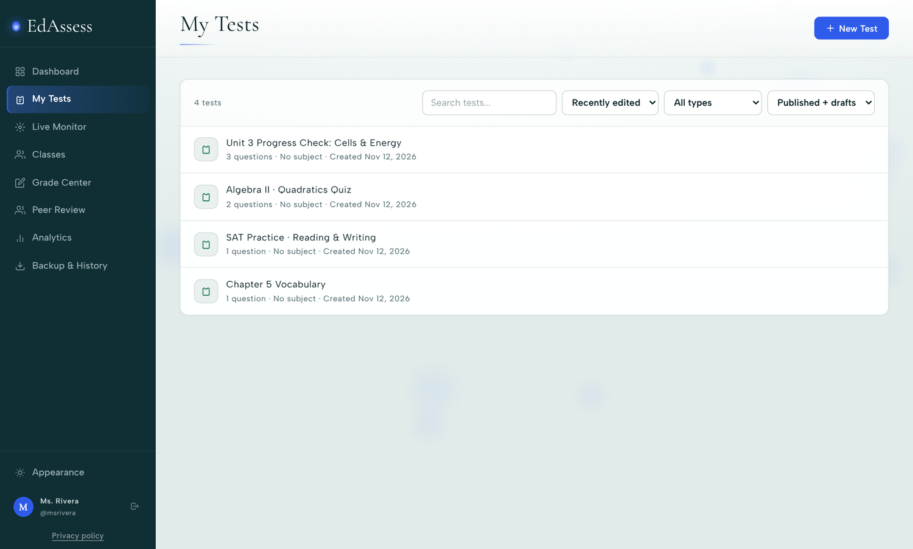
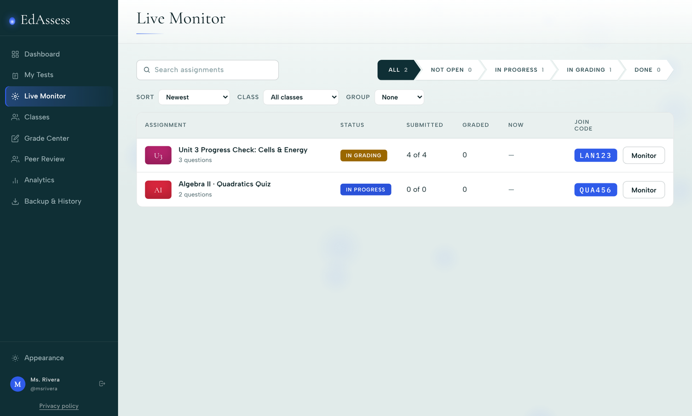
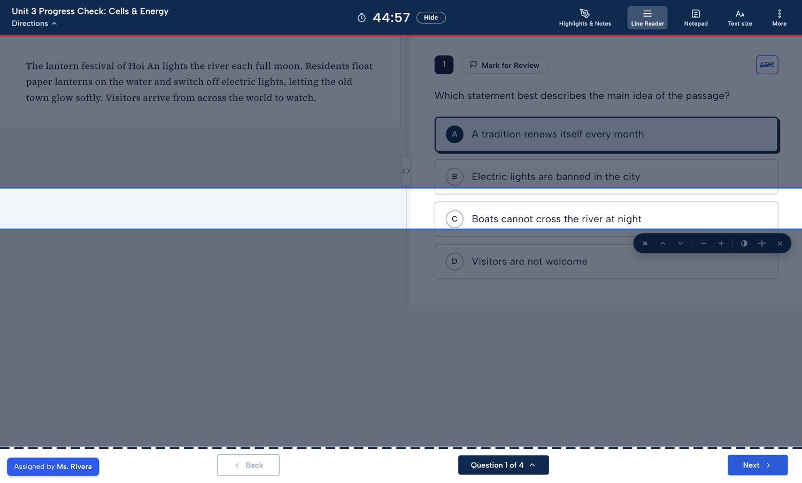
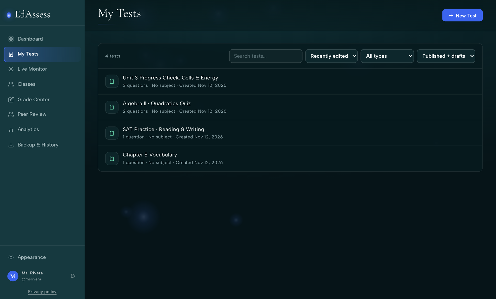

# EdAssess

**A calm place to run tests, surveys and classes.**

Write a test, hand your students a short code, watch the room fill up, and grade it all without leaving the page.

[**Open EdAssess**](https://edassess.netlify.app) · [Changelog](CHANGELOG.md) · [Contributing](CONTRIBUTING.md) · [MIT License](LICENSE)

 

---

## Why this exists

EdAssess started as a tool for online tutoring. I kept bouncing between one app for quizzes, another for rosters, a folder of links for materials and a spreadsheet for grades, and none of it talked to the rest. So this puts it all in one spot.

A teacher writes a test, shares a code or posts it to a class, watches students work in real time, grades the results and sends scores back. It also prints: paper tests, answer sheets that students or teachers can photograph for instant scoring, and reports for every kind of result. Students open a link, type a name and start. There is nothing to install, and if the Wi-Fi drops halfway through, their answers are kept on their device and sent when the connection comes back.

Three ideas shaped it:

- **It should be calm.** Light and night themes, gentle motion, and nothing shouting for your attention.
- **It should be one place.** Tests, surveys, classes, materials, live monitoring, grading, peer review, printing and analytics all live together.
- **The exam room should feel like a real exam.** Students get a focused screen modeled on AP Classroom, with the tools they actually need.

EdAssess is free and open source under the MIT License. You can use the hosted version, or run your own copy (see [Hosting your own](#hosting-your-own)).

---

## What's inside

### For teachers

#### Tests and surveys

Build tests with multiple choice, multi-select, short answer, essays, passages with sub-questions and upload-your-work questions. Add rubrics to essays, put images and reading passages beside questions, and make sectioned SAT-style tests with scaled scoring. You can pull in questions from your other tests, preview everything exactly as a student will see it, and rely on autosave, which tells you plainly when everything is saved.

More question types are available for assessments and surveys:

- **Ranking:** students put items in order, with optional partial credit.
- **Matching:** students pair items from a shuffled menu.
- **Fill in the blanks:** write a sentence and put answers in double curly braces, like `{{Paris}}` or `{{color|colour}}` for more than one accepted answer.
- **Number:** graded within a tolerance you choose.
- **Rating:** stars, numbers, or a 0 to 10 recommend scale.
- **Grid:** rows of statements against a scale such as Strongly disagree to Strongly agree.
- **Availability calendar:** pick a date range, weekdays, a daily window and a slot length. Each student sees the grid in their own time zone and drags across the times they can do. Your results show a heat map and a list of best times.

Choose **Survey** instead of **Assessment** when you just want to ask people things. A survey has no points, keys, rubrics or lockdown, and it stays out of the Grade Center and your averages. Results show response counts and rates, a chart for every choice question, averages for rating scales, written answers with common words pulled out, every individual response and a CSV export. A **Hide names** switch shows "Respondent 1, 2, 3" on screen. Students still type a name to get in, so for truly anonymous answers tell them to keep it generic.

#### Running it live

Hand out a join code or post the test to a class. The Live Monitor shows each assignment moving from Not open to In progress to In grading to Done, and you can sort, filter by class and group things so a heavy week stays readable. Students can message you from inside the exam, and you can reply with more than one line.

Assignments can be **published now, saved as a draft, or scheduled**. Students never see a draft, and a draft assignment's link will not open until it goes live.

#### Grading with the full picture

Objective questions are graded automatically and essays by hand. Rubrics support several scoring models at once: scored criteria with performance levels, checklist items, deductions with a cap, and bonuses. There are more than twenty ready-made templates, a personal library, JSON copy and paste, a scoring guide, a model answer and a comment bank. Clicking a level updates the score on the spot without redrawing the page, and each criterion can carry its own feedback. You can override a score, leave multi-line comments, or apply a curve. Peer feedback appears next to your grading, and one switch hides it from the student. Release scores when you're ready.

The class gradebook is one grid. Click any score to open that student's work. Averages are calculated for you, and anything that still needs a look is flagged.

#### Classes that feel like a classroom

Every class has Stream, Classwork, Collaboration, Grades and People tabs. Post announcements and materials, assign a test in a click, invite students by name and share a class code you can regenerate whenever you like. Every class also gets a four digit **class ID**, and every student has a permanent six digit **student ID** (used on answer sheets, see Printing and scanning).

Classwork works like Google Classroom: a Create menu (Assignment, Material, Topic), a topic list, and one stack of items per topic that you can drag into order. Materials can be published now, saved as drafts or scheduled, and each item carries a chip showing its state. Posting sends a push notification to students (see Notifications).

Each class gets its own color and the Classes page shows what needs your attention. Press Ctrl K anywhere to jump to a class, test, student or assignment.

New teachers (and every existing one) get a short guided tour with a practice class and sample test. It walks through building an assessment, the lockdown settings, a preview from inside a test, classes and collaboration, and shows where to join a class as a student. You can replay it any time from Search, Take the tour.

Co-teachers do not need an EdAssess account or to share an email address. The class owner creates one editing link for the teacher folder. When a co-teacher adds a file, the owner's session makes its own copy and removes the original, so the owner is the only name on files in Google Drive. EdAssess never reads or stores anyone's email for this.

Not everything has to go to everyone. Choose Who can see this on any topic, material or assignment to limit it to groups you create or to students you pick by hand. Students only receive what they are allowed to see, and nobody is told who else was included.

#### Files and Collaboration (Google Drive)

A teacher who works alone sees a **Files** tab. The class has a single Drive folder that anyone with the link can view, and posting a material makes its file available to students. As soon as a co-teacher joins, the tab becomes **Collaboration** with the two folders described below. Files in both tabs are shown in separate lists.

Anonymity comes first, so **nothing is ever shared by name or email.** Each class has two Google Drive folders that work by link:

- **Teacher folder:** anyone with the link can edit. This is where co-teachers build materials together.
- **Student folder:** anyone with the link can view. A file moved here is what students see.

Teachers sign in with Google once. After that everything syncs on its own: whenever the Collaboration tab opens, and once a minute while it stays open. EdAssess creates an **EdAssess** folder in their Drive with a folder per class inside it. The two class folders appear there for every teacher of the class, as real folders for the owner and as shortcuts for co-teachers. EdAssess never reads or stores anyone's email address.

The **Collaboration** tab is visible only to a class's teachers. It lists every file in both folders, whoever added it, and offers:

- a **Create** menu for a blank Doc, Slides or Sheet in the teacher folder
- **Move to student folder** and **Back to teachers only** for each file. Everything students see is owned by the class owner. Google does not let one person move or give away another person's file, so a file owned by a co-teacher is copied into the student folder by the owner, and the class owner can press **Allow instant moves** once so that a co-teacher's Move happens immediately. Without that approval a co-teacher's request waits until the owner's tab syncs
- **Pause student access** while you are editing, and **Restore student access** when you are done. Pausing removes the link permission, so students cannot open the folder until you restore it.
- notes on each file, so co-teachers can talk about it in place
- **Push to classwork**, live, as a draft or scheduled
- a one-step **Share my tests with co-teachers** for everyone teaching the class

Files attached to class materials move into the student folder when the material is posted. A scheduled material moves at the time it goes live, and until then students see the material without the link. Students see an **Open the class files folder** link in Classwork while access is on. Pasted Google links work too: any Docs, Sheets, Slides, Forms or Drive link is recognized, and **Embed** lets students preview the file on the page. In **Post material** you can also press **Add from Google Drive** to pick files.

Without the Google settings below, all of this still works with pasted links. See [Turning on Google Drive](#turning-on-google-drive).

#### Peer review
Pair students up for anonymous, rubric-based feedback. You choose two lists: the responses to review (real submissions and sample responses you write) and the reviewers (students who took the test, whole classes, or names you type). Reviewers who never took the test see the work with no author shown. It shows up in each student's account the moment it is assigned, and teachers and students use the same review screen. Grader-only material such as the scoring guide and model answer is never sent to a student's browser.

#### Student view and student mode
Inside any class, **Student view** opens the student side in a new tab. **Preview this class** is read-only, while **View as a student** lets you use the app as one student, including taking or submitting an assignment (it is marked as done by you). A bar across the top always shows who you are viewing as, and these sessions last two hours.

To join a colleague's class as a learner, they invite you with `@yourusername`, and you press **Student mode** in your sidebar. Your teaching account is never touched.

#### Printing and scanning
Everything can go on paper, laid out for paper rather than copied from the screen. Open **Print** in the sidebar, press <kbd>Ctrl</kbd>+<kbd>Shift</kbd>+<kbd>P</kbd>, or search "Print" in the command palette to get the Print Center with a live preview.

- **Test on paper** with name, date and class lines, bubbles, ruled lines for essays and boxes for ranking and matching. Choose paper size, text size and up to four versions that shuffle questions and options. Images print too.
- **Sections** print as booklets, each with its own header, time limit and special instructions. A **STOP page** follows every section, and EdAssess adds blank pages so every STOP page and new section lands on an odd page and cannot be peeked at.
- **Answer keys** for each version, and **bubble answer sheets**.
- **Results** for one student or the whole class (one report per page with a class summary), plus class summaries, gradebooks, roster and attendance sheets, scoring rubrics and survey results.
- **Print this page** prints what you are looking at with the menus hidden.

**Answer sheets** are fully customizable and saved with the test: title, instruction line, extra header fields, bubbles per question, letters (A, a or 1), bubble shape and size, row spacing, columns, shaded row groups and which header lines appear. Text never overlaps. Each sheet has four corner squares and small timing rectangles beside every column of bubbles, which keep the scanner accurate even on curved or tilted photos.

Every sheet has a **Student ID** block and a **Class ID** block, and each can be pre-printed or left blank:

- Choose a class in the Print Center to pre-print the class name (above the ID) and class ID, or leave it blank for students to write and bubble.
- Print one sheet per student with their name and student ID already filled in.
- The **version is never pre-printed**. Students bubble their own. If they forget, the scanner asks which version it was.

**Scanning:** open **Scan bubble sheets**, then take or upload a photo of each sheet. The scanner finds the corner squares, straightens the page, reads the ID blocks, the version and every bubble, and scores multiple choice right away. It matches the sheet to the student by their ID, fills in the score, and flags anything faint or double marked for you to fix before you record it.

**Students can turn in a paper sheet themselves,** without opening the test. A **Scan sheet** button appears beside Start on their assignment list, and every sheet can carry a **turn-in QR code**. Students scan the QR with their phone camera (or open **Scan answer sheet** from the login page or their home screen), photograph the sheet, check every answer against their paper, fix anything flagged, tick the confirmation and submit. If the QR is damaged, they can type the assignment code printed beside it. No sign-in is needed unless the assignment requires an account. Nothing is scored or shown to the student until they confirm every answer, and results appear afterward only if you have released them. You can turn student scanning off per test.

#### And a few more things
- **Grade Center** and **Analytics** for results across assignments
- **Backup and History**, so a careless delete is never permanent
- **Co-teachers** who share a class with you
- A **command palette** (<kbd>Ctrl</kbd>+<kbd>K</kbd> or <kbd>/</kbd>) to search for anything, and <kbd>?</kbd> to see every shortcut
- Every screen has its own address, so Back, Forward and Refresh return you to the same place

### For students

#### Your own home

Sign in with a first name and last initial. Your classes, what's due, your grades, any peer reviews waiting for you and your **student ID** are on one page. An account is optional for many assessments. If your teacher gave you a code, you can usually just type it in. Students are asked to allow notifications the first time they sign in so new posts reach them even when EdAssess is closed.

#### Peer review

When a review is assigned to you, it simply appears. You read a classmate's response (they won't know it's you, and you won't know it's them), score the rubric and leave feedback.

#### The exam room

The exam screen is calm and navy and stays out of your way:

- a timer in the top bar that you can hide
- a question navigator, Mark for Review and an answer eliminator
- Directions, a Reference sheet and a built-in Calculator when your teacher allows them
- passages beside the questions, with a divider you can drag
- autosave on every answer, with a clear "All changes saved"

<table>
<tr>
<td width="50%"></td>
<td width="50%"></td>
</tr>
<tr>
<td><b>Line Reader</b> is a spotlight strip that dims everything else. Drag it, resize it, nudge it line by line with <kbd>Alt</kbd>+<kbd>Up</kbd> or <kbd>Down</kbd>, change how dim it is, or let it follow your mouse. <kbd>Esc</kbd> closes it.</td>
<td><b>Notepad</b> is private scratch space, with one page per question and one for the whole test. Drag it, resize it, minimize it. It stays on your device.</td>
</tr>
</table>

You also get **Highlights and Notes** for marking up passages and **Text size** for a bigger reading area. Shortcuts: the left and right arrows change question, <kbd>A</kbd> to <kbd>D</kbd> pick an answer, and <kbd>N</kbd> opens the Notepad. If your teacher sends you a survey, there is nothing to prepare for. Answer honestly and submit. Nothing is graded.

### Comfortable on purpose

- Light by default, night on request. Switch from **Appearance** in the sidebar.
- Text is checked for contrast in both themes, including hover and selected states.
- Text size is adjustable. Motion stays gentle (pages ease in, buttons respond, dashboard numbers count up) and switches off entirely if your device asks for reduced motion.
- If the connection drops, your work is kept on the device and retried automatically.
- The layout adapts to phones, and nothing overlaps or runs off the screen.

---

## Terms and privacy

EdAssess has a plain-language **Terms of Service** (look for **Terms** on the front page, the sign-in screens and the sidebar, or add `?terms=1` to the site address). The big points:

- Teachers must be at least 13. Students who are 12 or under need a parent or guardian's permission before making an account.
- Cheating, harassment, scraping, trying to break the sign-in or exam protections, and using EdAssess for things that aren't teaching are not allowed.
- The hosted service is provided as is, without liability, under Texas law.
- The source code is open source under the MIT License. The Terms cover the hosted service at edassess.netlify.app, and the license covers the code.

The privacy policy is built into the app too (look for **Privacy policy** or add `?privacy=1` to the site address). We keep data collection small: students don't need an email address, there are no ads and no tracking, and passwords are stored only as salted hashes. Connecting Google Drive does not give EdAssess anyone's email, and folders are never shared with named people. The policy explains what is stored, who can see it, which outside services are involved, how long things are kept and how to ask for deletion.

---

## Hosting your own

EdAssess is one page (`index.html`), one service worker (`sw.js`) and one serverless function (`netlify/functions/data.js`). Deploy the folder to Netlify as it is. Data lives in Netlify Blobs, so there is no database to set up.

| Setting | What it does |
| --- | --- |
| `EA_AUTH_SECRET` | Any long random phrase. Signs sessions and derives the push notification keys. Required. |
| `EA_TEACHER_KEYWORD` | The secret word teachers type to create an account. Required. |
| `EA_PUSH_CONTACT` | A `mailto:` address push services can see. Optional. |
| `GOOGLE_CLIENT_ID`, `GOOGLE_API_KEY`, `GOOGLE_APP_ID` | Turn on Google Drive. Optional. |
| `GOOGLE_CLIENT_SECRET` | The OAuth client's secret. Only needed for instant moves. Optional. |

Notifications use Web Push through `sw.js`, which must be deployed at the site root next to `index.html`.

### Turning on Google Drive

This takes about ten minutes, and without it everything else still works.

1. In Google Cloud Console, create a project and enable the Google Picker API and the Google Drive API.
2. Configure the OAuth consent screen and add your site address under Authorized JavaScript origins for a new OAuth client ID (Web application).
3. Create an API key and restrict it to your site and the Picker API.
4. In Netlify, set `GOOGLE_CLIENT_ID`, `GOOGLE_API_KEY` and `GOOGLE_APP_ID` (the project number), then redeploy.

For instant moves, copy the OAuth client's secret into `GOOGLE_CLIENT_SECRET`. The owner's approval stores one encrypted long-term token on the server, which is removed when they turn instant moves off. Sign-in asks for full Drive access. That is what lets EdAssess create the class folders, add each co-teacher's shortcut and list everything inside a class folder. It does not ask for the account email. For a school or small team, keep the Google Cloud app in Testing or Internal mode. Public use needs Google's app verification.

### Running it locally

Install the dependencies with `npm install`, add the two required settings to a local `.env` file, and run `netlify dev`. See [CONTRIBUTING.md](CONTRIBUTING.md) for the project layout and how to run the tests.

---

## Contributing

Issues and pull requests are welcome. [CONTRIBUTING.md](CONTRIBUTING.md) explains the layout and the house rules, and every change gets a line in [CHANGELOG.md](CHANGELOG.md).

## License and credits

EdAssess is released under the [MIT License](LICENSE). Anyone may use, copy, change and share it, including in schools and businesses.

It was designed and directed by its maintainer and built with the help of [Claude](https://claude.ai), Anthropic's AI assistant.

Made with care for classrooms. Questions or ideas? Open an issue.

